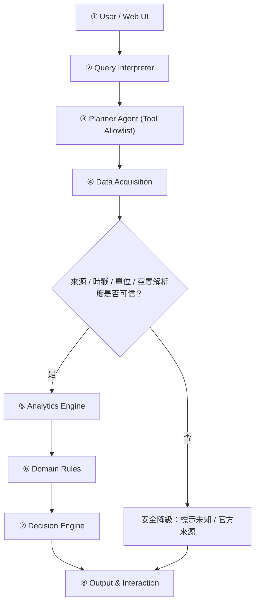

# DESIGN.md｜AirGuard AI 系統設計（v2）

> **狀態：Architecture / Implementation Specification，尚非完成系統的實作說明。**  
> 2026-11-24 範圍更新：原 11/03 提案為歷史基準；路線級導航、個人／累積暴露、SHAP 及活動改時已升級為最終必做。**功能驗收依據**：[SRS](./myplan/04_系統功能需求與驗收標準.md)。

## 01｜Problem → Requirements

使用者需要的不只是顯示當前 AQI，更需要「何時出門、活動多久、是否改道、可能承受多少估計暴露及為何如此建議」的可追溯決策。系統將官方 AQI 與模型 PM₂.₅、時空資料、健康活動指引、Agent 受控工具及資料品質保障整合，並進行客觀驗證。

- **M1 測站級核心**：FR-01～04、FR-10～12。
- **M2 個人決策**：FR-05～07（時間比較、SHAP、累積暴露）。
- **M3 路線級導航**：FR-08～09（多路線、熱點、空間證據與獨立驗證）。
- 全部為**最終必做**，但不承諾任何尚未驗證的路段污染排名。

## 02｜System Architecture（①–⑧）



| 編號 | 模組 | 責任 |
|---|---|---|
| ① | User / Web UI | 位置、起訖點、活動時間、時長、交通方式、活動強度、敏感性輸入 |
| ② | Query Interpreter | 自然語言解析、站點／時區／日期／路線歧義判定 |
| ③ | Planner Agent | 受限於 Tool Allowlist、上限／超時／來源檢核；不自行計算不存在的污染值 |
| ④ | Data Acquisition | 環境部 AQI／PM₂.₅、歷史 CSV、氣象、路網、路段推估／驗證資料 |
| ⑤ | Analytics Engine | ML 1／3／6h、誤差／SHAP、候選時段、累積暴露、路線時空積分 |
| ⑥ | Domain Rules | 官方 AQI 分級、一般／敏感族群活動指引、版本記錄 |
| ⑦ | Decision Engine | 比較時段／路線，檢查決策依據與資料可信度，沒有資料則拒絕排名 |
| ⑧ | Output & Interaction | 清楚區分官方與預測、來源與時戳、建議、圖表、地圖、不可用說明 |

## 03｜Data Acquisition / Schema / Provenance

**原提案官方來源**：環境部 AQX_P_432（即時 AQI）、AQX_P_488（歷史 AQI）、AQX_P_13（逐時監測）。實作時須重新核對 API 版本、欄位、更新頻率、單位及授權；氣象數據不得假設為已可於 t 時間取得。新增 M3 所需路網、交通方式／行程時間、道路污染時空估算及**獨立驗證**資料。

### 03.1 所有資料的共同欄位

- `source_id`, `source_url`, `station_id` 或 `segment_id`, `geometry`, `observed_at`, `published_at`, `fetched_at`, `timezone`, `unit`, `averaging_window`, `quality_flag`。
- 預測：`forecast_issued_at`, `forecast_target_at`, `horizon_hours`, `model_version`, `predicted_pm25`, `uncertainty`。
- 路線：`route_id`, `origin`, `destination`, `departure_at`, `travel_mode`, `segment_ids`, `segment_duration`, `segment_concentration_estimate`, `spatial_coverage`, `validation_status`。
- 暴露：`activity_id`, `duration_h`, `exposure_index`, `exposure_unit`, `assumptions`, `coverage`, `confidence`。
- 各回應必須能說明**來源、時間、空間尺度、運算規則與未知欄位**。

### 03.2 防時序洩漏

以「資料在預測發出時間 `t` 是否已公開取得」而非僅以觀測時間判定可用性。補值、滯後特徵、Rolling windows、標準化、調參、區間校準不得使用未來資料。

## 04｜Analytics / AI Model

- Target：測站尺度原始每小時 PM₂.₅，單位 μg/m³；預測時距 `h∈{1,3,6}`。
- Baseline：Persistence、Seasonal Naive。
- Candidate models：Ridge、Random Forest、XGBoost；使用歷史 PM₂.₅ 滯後值／滾動統計與當時可得氣象、時間特徵。
- Protocol：**70／15／15 chronological train／validation／test + rolling-origin**；最後 test 一次性檢驗。
- Metrics：MAE、RMSE、Skill vs 固定 baseline、分測站／時距／污染事件；報告數量與估計誤差，不預設任何模型會勝出。
- SHAP：M2 必做，分別呈現局部與整體特徵貢獻；**不能據此宣稱因果**。
- 若模型不優於基線，保留可信 baseline 或官方已發布趨勢，並誠實報告。

## 05｜Domain Knowledge / Safety

- 2025 年起修訂的環境部 AQI 分級及活動指引：須以實作時最新**官方版本**驗證並記錄生效日期。
- **官方 AQI** 由官方來源提供；模型只有 PM₂.₅ 濃度，不自行構造「未來官方 AQI」。
- 不提供個人醫療診斷、治療或健康結果保證。
- 資料過期／缺漏／超出時距／站點歧義／路段證據不充分，顯示不可用、限制或需要澄清，不捏造精確數值。

## 06｜Exposure / Routing Methods（M2、M3 必做）

### 06.1 個人暴露估算
以 `ExposureIndex = Σ(C_i × Δt_i)` 估算每段活動**濃度–時間積分**（μg·h/m³）。每日總量是各段估算加總，顯示地理／時間覆蓋、測站或路段假設和未知區間；**非個人實際吸入量**。活動強度用於活動建議及假設記錄；若引入呼吸率模型須明確另外建模與驗證。使用者暴露預算僅為自行設定的比較門檻。

### 06.2 路線比較
同 OD、出發時間與交通方式取得多條候選路線；建立路段濃度估算 `C(segment,t)` 與行進時間，計算 `RouteExposure=Σ(C_i×Δt_i)`，呈現行程時間／距離、污染熱點、估計路線暴露與不確定性，並提供改道與改時候選。

- **路段尺度先決條件**：路網幾何與路段通行時間、時空污染估算、足夠覆蓋與適當外部資料。
- **獨立驗證門檻**：須以獨立路旁／移動量測或可比較資料驗證路線排序，公開樣本數、誤差、覆蓋率及限制。
- **Fail-safe**：若只取得測站點位或路段資料未驗證，不得宣稱某路線空氣較乾淨；可顯示普通導航候選路線及官方測站風險資訊，並明示暴露排名不可用。此狀態**不視為 M3 空品排序驗收通過**。

## 07｜Agent / Pseudocode

```text
01 request = parse(query, location, time, activity, group, OD, travel_mode)
02 validate_required_fields_and_horizon(request)
03 plan = select_tools_from_allowlist(request)
04 official = fetch_official_aqi_and_timestamp(plan)
05 hist, weather = load_information_known_at_t(plan)
06 if insufficient_or_stale: return safe_fallback_with_sources()
07 forecast = forecast_pm25(hist, weather, horizons=[1,3,6])
08 uncertainty, shap = explain_forecast(forecast)
09 rules = load_versioned_official_activity_rules(official)
10 times = compare_eligible_activity_windows(request, forecast, rules)
11 personal = estimate_activity_and_daily_exposure(request, times)
12 if request.has_route:
13     routes = acquire_candidate_routes(request.OD, request.mode)
14     routes = estimate_segments_if_validated(routes, spatial_data)
15     if unvalidated: flag_route_exposure_unavailable()
16 decision = conservative_decision(times, personal, routes, rules)
17 response = attach_sources_units_timestamps_limits(decision)
18 if fail_guardrail: response = safe_fallback_with_sources()
19 record_audit_trace()
20 return response
```

核心 AI Agent 做情境理解與工具調用；公式計算與官方規則由可測試的確定性工具執行。受控 ReAct／Tool Calling 只是設計方案，未聲稱已實作。

## 08｜Implementation Mapping（預計技術，不是現有程式）

| 層次 | 技術候選 | API 契約草案 |
|---|---|---|
| Frontend | React／Next.js、地圖、圖表 | 情境查詢、路線比較、暴露視圖、來源卡片 |
| Backend / Agent | Python FastAPI、LLM Function Calling＋規則引擎 | `POST /agent/query` |
| Data | MOENV adapters、氣象及路網、cache | `GET /stations`, `GET /aqi` |
| Forecast | scikit-learn、XGBoost、版本化模型 | `POST /forecast` |
| Exposure | 可稽核濃度×時間計算模組 | `POST /exposure/estimate` |
| Routing | 路網與路段時空污染推估 | `POST /routes/compare` |
| QA | pytest／離線回測／固定案例 | `tests/`, `experiments/`（預計） |

以上路徑為**設計草案，不是已部署端點**。

## 09｜Experiments / Evaluation

- **Track A（ML）**：1／3／6h、MAE／RMSE／Skill Score，與 Persistence／Seasonal Naive 比較；rolling-origin、分測站／季節評估。
- **Track B（Agent）**：≥30 固定案例；工具選擇正確率、來源完整率、規則一致率、安全降級率、P50／P95 延遲。
- **Track C（Personal／Route）**：暴露計算單位及累積結果可核算；同 OD 路線比較，路段資料覆蓋、模型誤差、獨立排序驗證與決策取捨；MEE 僅在來源與公式核查後採用。

所有研究指標須附資料期間、測站／路段範圍、切分、版本、限制及負結果。不能引用其他研究的降暴露百分比作為本系統成果。

## 10｜Implementation / How to Run / Results

**截至 2026-11-24**，此 Repo 已有提案／研究文件，但尚未有可驗證的前後端／ML 程式碼與實測報告，因此**How to Run、Results、Demo 必須等實作後補上**，不得編造連結、指令、效能或完成狀態。

更新記錄：
- 2026-11-03：正式提案（測站尺度 PM₂.₅ 預測＋領域 Agent）。
- 2026-11-11：整合後續約 500 字摘要之研究證據與進階想法。
- 2026-11-24：v2 正式將路線級導航、個人暴露、SHAP 與替代時段升級為必做，擴充 Track C／驗收門檻。

詳見 [Roadmap](./myplan/05_開發路線圖與任務清單.md)、[變更紀錄](./myplan/06_提案與摘要整合說明.md)、[原始提案](./proposal/README.md)。
