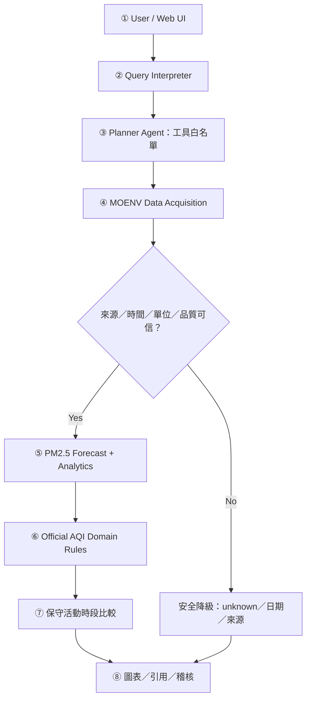

# AirGuard AI｜智慧空氣品質預測與生活決策代理人

> **AIoT-DA｜物聯網數據分析與應用｜第二組期末專題**  
> 組長：林宏陽（7115056179）｜組員：蔡明憲（7115056013）、許鈵昆（8114056002）  
> **正式研究／設計版本：v3（2026-11-24）**｜本課堂 Repository 文件同步基準：[`AirGuard-AI` main](https://github.com/sam052003/AirGuard-AI/tree/main)，同步時基準 Commit `db399118`。

## Repository 定位與最新狀態

**本 Repository（`AIoT_DA_1111`）是課堂研究、提案、歷史文字備份與 v3 文件鏡像**；實際程式、單元測試、GitHub Actions、PR、後續模型與 Web 開發均在 **[AirGuard-AI 正式期末專題 Repository](https://github.com/sam052003/AirGuard-AI)**。本倉庫不應被視為可直接啟動的系統 Demo。

| 階段 | 已有證據 | 狀態 |
|---|---|---|
| v3 提案／研究 | Word、PPTX、摘要、A–F、Deep Research、DESIGN、SRS | **已整理** |
| W1 — 官方資料與品質工程 | [AirGuard-AI PR #8](https://github.com/sam052003/AirGuard-AI/pull/8) 已合併；API 接入、合成測試、資料快照與品質報告；CI Python 3.11／3.12 通過 | **已完成 W1 開發與 PR 驗收** |
| W2 — PM2.5 Baseline | [AirGuard-AI Issue #10](https://github.com/sam052003/AirGuard-AI/issues/10)：Persistence、Seasonal Naive、時序回測 | **已建立開發任務；本次同步時尚無可核對的 W2 成績** |
| W3 — Ridge／RF／XGBoost | 模型比較及固定測試集 | **規劃中** |
| W4–W6 — Agent、Web、最終驗證 | 工具白名單、官方 AQI 規則、活動比較與成果展示 | **尚未完成** |

> **誠實標示**：W1 的臺中測站歷史統計來自正式倉庫的本機真實 API 驗證報告；GitHub CI 使用的是合成 fixtures。沒有已完成的模型 MAE／RMSE、Agent 準確率或可操作 Web Demo，不得把「預期成果」寫成實測結果。

## 一、研究摘要 Abstract（v3 約 500 字）

空氣污染仍影響民眾的戶外活動安排。WHO 估計 2019 年全球室外空氣污染造成約 **420 萬人過早死亡**；臺灣環境部公布 PM2.5 全國年平均濃度由 2019 年 **16.2** 降至 2025 年 **12.8 μg/m³**，顯示長期改善，但年度平均並不能直接回答個別監測站、特定時段的活動風險。現有資料平台可提供官方 AQI 與監測值，使用者仍需自行解讀時段、活動強度及資料有效性。

本研究提出 **AirGuard AI：智慧空氣品質預測與生活決策代理人**，以臺中具足夠歷史資料的官方監測站為試點，整合環境部即時 AQI、歷史逐時 PM2.5、站點座標與官方活動指引。系統以 **Persistence、Seasonal Naive** 為基準，比較 **Ridge、Random Forest、XGBoost** 的未來 **1、3、6 小時** PM2.5 預測，以時間切分及 Rolling-origin 避免資料洩漏，透過 MAE、RMSE 與 Skill Score 報告實際誤差。受約束的 AI Agent 解析使用者情境、調用資料與模型工具、檢查來源及時間，在資料有效時比較戶外活動候選時段，並提供測站濃度與活動時長的積分估算及不確定性。

本研究另規劃以至少 **30 個固定 Agent 情境**檢驗工具選擇、引用正確、官方規則一致與 API 失效降級。SHAP 與手動活動記錄可視進度延伸。由於公開測站資料不足以獨立證明道路級污染差異，本期末系統**不提供低污染路線排名、個人真實吸入劑量或醫療診斷**。預期成果是一套具可重現模型測試、來源追溯與保守決策規則的網頁原型；**所有成效均待後續實驗驗證**。

文字版來源：[研究摘要](myplan/01_研究摘要_約500字.md)｜[WHO 背景資料](https://www.who.int/news-room/fact-sheets/detail/ambient-(outdoor)-air-quality-and-health)｜[環境部空品趨勢](https://enews.moenv.gov.tw/moenv-news/zh-tw/News/1844)。

### Abstract A–F Research Story（教師要求的六段式）

| 段落 | 核心內容 |
|---|---|
| **A. Attention Getter — Motivation** | 室外空污構成健康風險；長期年平均改善，不等於每個測站與活動時段都可安心出行。以 WHO、環境部官方統計說明重要性。 |
| **B. But — Challenge** | 現有 AQI 查詢多是「現在狀態」，缺少對接下來 1／3／6h、活動時長、敏感族群、資料缺漏及模型誤差的整合；測站資料亦不足以推論道路真值。 |
| **C. Cure — Proposed Solution** | 提出 **AirGuard AI Domain AI Agent**：以可信測站資料與短期 PM2.5 預測支援保守的戶外活動時段比較。 |
| **D. Development — Method** | MOENV 四組資料集＋資料品質檢查＋Persistence／Seasonal Naive／ML＋官方 AQI Domain Rules＋Tool-Allowlist Agent＋來源與不確定性。 |
| **E. Experiments — Evaluation** | 逐站時間切分 70／15／15、Rolling-origin、MAE／RMSE／Skill；至少 30 個 Agent 案例與來源、安全降級測試；比較 Rule-only 與 Agent＋ML＋Rules。 |
| **F. Findings — Expected Outcomes** | **預期**產出能追溯來源、避免超出證據範圍的測站級活動決策原型；預測效能與決策改善必須以未來實驗確認，不能預先宣稱成功。 |

## 二、Introduction｜緒論（A–F）

**A. Attention Getter**：空污是持續的環境健康風險；官方年度統計與使用者眼前的活動安排屬不同時間尺度。

**B. Background**：環境部提供官方 AQI、逐時污染物、歷史 AQI 與測站座標；使用者可能想知道「接下來兩小時內，什麼時間慢跑 40 分鐘較值得考慮？」而不只是讀一個 AQI 數字。

**C. Problem**：如何將**真實測站觀測、未來 1／3／6h PM2.5 預測、官方活動指引與使用者情境**整合成可追溯、保留不確定性的答覆？

**D. Existing Limitations**：觀測／發布／取得時間常被混淆；缺值不可當成 0；單站數值無法證明道路級差異；平均預測誤差不等於決策一定有效。

**E. Innovation**：不讓 LLM 自行捏造 AQI 或 PM2.5；以**白名單工具調用、確定性 Domain Rules、模型版本／來源卡、缺值／時效安全降級**建立證據導向代理人；增加「活動時間選擇」的決策評估。

**F. Contributions（預期貢獻）**：① 可重現的臺中官方監測站資料與品質報告；② 跨 1／3／6h 的公平模型基準；③ AI Agent＋官方規則的可稽核活動比較；④ 測站尺度濃度×時間估算與系統失效處理。這些是**研究目標，不表示所有模組已完成**。

## 三、Related Work｜相關研究（AI Technology × Domain Know-how）

本提案依老師規範，以**約 50% AI／資料分析方法、50% 空氣品質與暴露領域知識**組織文獻。下表為供提案閱讀的精簡 Article Summary；完整爭論、證據與限制見 [Deep Research](research/deep-research-v3-evidence-2026-11-24.md)。

| Ref／年份 | Problem／領域 | AI Method／Domain Knowledge | Dataset／Evidence | Findings／對本案的啟發 | Limitation |
|---|---|---|---|---|---|
| [18] 2023 | 時序預測評估（AI） | Rolling-origin、避免 leakage、預測評分 | 預測方法論研究 | 固定時間切分與可重現誤差檢查 | 不是臺中空品的實測結果 |
| [19] 2022 | 複雜模型與基準比較（AI） | M5 forecasting competition | 零售銷售時序 | 需要在一致條件下比較基線與 ML | 零售資料不能直接代表 PM2.5 |
| [21] 2023 | 多步查詢與工具使用（AI） | ReAct Reasoning + Acting | 論文中的問答／互動任務 | Agent 能協助選工具，但需限制權限 | 不等於本案已通過 Agent 驗收 |
| [23] 2017 | 模型可解釋性（AI） | SHAP 特徵貢獻 | 可解釋模型研究 | P1 可呈現模型為何做出預測 | 特徵貢獻不是空污因果 |
| [16] 2021 | 健康空品暴露（Domain） | WHO Air Quality Guidelines | 公共衛生證據綜整 | 健康影響取決於污染物與暴露尺度 | 不能直接換算個人安全時數 |
| [17] 2018 | 時空暴露估算（Domain） | 時間活動模式、微環境、concentration vs. dose | 空氣暴露研究 | 僅用測站濃度×時長應標「指數」 | 不是個人實測吸入劑量 |
| [20] 2026 | 小時 PM2.5 預報對生活安排的用途（Domain） | 預報與決策適用度比較 | 美國野火季研究 | MAE 較佳未必代表活動時段選擇較佳 | 非臺中資料；效果不可外推 |
| [24] 官方 | 臺灣 AQI／活動分級（Domain） | 多污染物平均窗與官方建議 | 環境部 AQI 內容 | 正式 AQI 與單項 PM2.5 不同 | 規則需依官方現行版本校驗 |

**Research Gap**：Existing Research → 仍缺少對**臺中官方測站逐時資料**的來源／時效／缺值稽核、1／3／6h 的可重現基線評估，以及與官方規則結合的保守活動決策驗收 → **AirGuard AI** 將這些流程串成可檢查的 Domain AI Agent。

## 四、Deep Research｜Q1／Q2／Q3

### Q1：五個核心思維模式

1. **情境與暴露優先**：濃度讀數必須結合活動時長、族群與時間；濃度×時間不是吸入劑量。
2. **時空解析度與資料追溯**：站點、單位、平均窗、三種時間戳及品質旗標缺一不可。
3. **Baseline-first／時序驗證**：Persistence、Seasonal Naive 先建立公平比較，避免資料洩漏。
4. **預測準確率與決策效度分開評估**：MAE 低不等於一定選對戶外活動時段。
5. **Agent 工具權限與領域護欄**：LLM 負責理解與編排；官方數值、規則與公式交由確定性程式。

### Q2：三項重要專業爭論

| 爭論 | 兩方論點 | 目前工程取捨／未解問題 |
|---|---|---|
| **複雜 ML vs. 簡單 Baseline** | 複雜模型有非線性優勢；也有過擬合、洩漏、運算成本風險 | 使用相同資料與 horizon 實測；**臺中哪類模型真正勝出仍未知** |
| **平均誤差 vs. 活動決策品質** | MAE／RMSE 可量化；選時失誤與污染尖峰可能更攸關使用者 | ML Track A 與決策 Track B 分開驗收；不可靠的排名可以拒絕 |
| **自主 Agent vs. 受控規則** | Tool Calling 增加彈性；LLM／外部內容可能越權或注入 | 採 Tool Allowlist＋輸出查核；比較 Rule-only 與 Agent＋ML＋Rules |

### Q3：十個深度理解問題（精簡版）

1. 為何逐時 25 μg/m³ PM2.5 不能直接換算官方 AQI？
2. API 成功但資料已過期三小時，Agent 應如何降級？
3. 1／3／6h 為什麼要分時距報 MAE？
4. 為何不可先隨機切分、再做 lag／rolling 與補值？
5. XGBoost test MAE 較低，就能宣布模型最好嗎？
6. 缺失小時能否補 0 代表沒有污染？
7. 為何 Σ(C×Δt) 的 μg·h/m³ 不等於吸入微克數？
8. 時段差異小於模型誤差時，為何不宜強行排名？
9. 有官方監測站座標，為何仍不能做可靠「最乾淨街道路線」排序？
10. API 回應包含惡意指令、SHAP 顯示風速重要時，如何防止 Agent 越權與因果誤讀？

每題完整推理、雙方證據／共識／未解問題與引用，請閱讀 [Deep Research 全文](research/deep-research-v3-evidence-2026-11-24.md)。

## 五、Proposed Scheme／Proposed Design

### 5.1 核心架構（八模組）



| 模組 | 工作與輸出 |
|---|---|
| ① Web UI | 測站選擇、活動內容與時長、一般／敏感族群 |
| ② Query Interpreter | 情境、時間／地點歧義、6h 時距解析 |
| ③ Planner Agent | 只調用白名單工具，受參數與上限限制 |
| ④ Data Acquisition | MOENV API、來源時間與品質、快照、站點 |
| ⑤ Analytics | PM2.5 1／3／6h、誤差、不確定性與濃度×時長 |
| ⑥ Domain Rules | 環境部正式 AQI 分級與族群活動指引 |
| ⑦ Decision | 只比較證據支援的候選時間，不做健康安全保證 |
| ⑧ Output | 分開顯示官方 AQI、模型預測、估算值、日期與限制 |

### 5.2 官方 Open Data

| Dataset | 用途 | 特別注意 |
|---|---|---|
| [AQX_P_432](https://data.moenv.gov.tw/dataset/detail/AQX_P_432) | 即時官方 AQI | 不等於單項 PM2.5 |
| [AQX_P_13](https://data.moenv.gov.tw/dataset/detail/AQX_P_13) | 歷史逐時 PM2.5 訓練主資料 | `MonitorValue00…23` 展開、missing／invalid／重複值 |
| [AQX_P_488](https://data.moenv.gov.tw/dataset/detail/AQX_P_488) | 歷史 AQI／觀測對照 | 不可把發布時間未知當作已知 |
| [AQX_P_07](https://data.moenv.gov.tw/dataset/detail/AQX_P_07) | 官方測站座標 | TWD97；不能代表整條道路 |
| [環境部 AQI 分級](https://airtw.moenv.gov.tw/cht/Information/Standard/AirQualityIndicatorNew.aspx) | Domain Knowledge | 依正式分級及族群指引 |

### 5.3 ML／實驗方法（Track A）

- **目標**：測站原始逐時 PM2.5（μg/m³），未來 **1／3／6h**。
- **Baselines**：Persistence `ŷ(t+h)=y(t)`；Seasonal Naive `ŷ(t+h)=y(t+h−24)`，只引用 `t` 時已可得資料。
- **候選 ML（W3）**：Ridge、Random Forest、XGBoost；不預設一定勝 Baseline。
- **切分**：各站依時間先後約 70% train、15% validation、15% test；validation 前向回測；test 保留。
- **評估**：`MAE`、`RMSE`、`Skill=1−MAE_model/MAE_Persistence`，分站與時距、同一有效樣本集合比較。
- **回測限制**：若歷史實際發布可得時間未知，標示 `backtest_mode=reconstructed_from_observed_at`，不可稱為嚴格 point-in-time 線上回測。

### 5.4 Agent／活動決策（Track B）

- **Agent**：從使用者的自然語言解析時間、活動、測站與族群，執行 `list_stations`、`get_official_aqi`、`get_pm25_history`、`forecast_pm25`、`get_official_guidance`、`compare_windows` 等白名單工具；不能替代官方規則。
- **官方與預測分流**：官方 AQI、原始 PM2.5、未來預測 PM2.5 與濃度×時間估算，各自標明來源與單位。
- **安全降級**：資料過期／缺值、模型不可用、站點歧義、超出 6h、工具失敗時，回覆資料不足或官方資訊，不能假造。
- **測站尺度指數**：`ExposureIndex = Σ(Concentration_μg/m³ × Duration_h)`，單位 **μg·h/m³**，*不等於個人吸入量或醫療安全值*。

### 5.5 有行號的 Pseudocode（規劃）

```text
Algorithm 1 — Evidence-Grounded AirGuard Agent
01 request ← ParseQuery(user_query, context)
02 if MissingRequiredFields(request): return AskClarification()
03 station ← ResolveOfficialStation(request.location)
04 plan ← SelectAllowlistedTools(request)
05 official, hourly ← LoadMOENVData(plan)
06 quality ← CheckSourceTimestampUnitAndCoverage(official, hourly)
07 if quality is insufficient: return SafeFallbackWithSources(quality)
08 horizons ← ValidateHorizon(request, allowed={1,3,6})
09 if horizons unsupported: return OutOfScopeResponse()
10 forecast ← ForecastVersionedPM25(hourly, horizons)
11 guidance ← GetVersionedOfficialAQIGuidance(official.aqi, request.group)
12 options ← CompareEligibleActivityWindows(forecast, guidance, request)
13 exposure ← SumStationConcentrationTimesDuration(options)
14 result ← AttachUnitsTimesSourcesUncertaintyAndLimitations(options, exposure)
15 if not VerifyResult(result): return SafeFallbackWithSources()
16 SaveRedactedAuditTrace()
17 return result
```

## 六、系統範圍與技術可行性（v3）

| 分級 | 功能 |
|---|---|
| **P0 必做** | 官方 AQI／站點地圖／歷史 PM2.5、資料品質、1／3／6h 短期預測、受控 AI Agent、官方活動指引、6h 內活動時段比較、Web、濃度×時間指數、雙軌評估與失效降級 |
| **P1 可選** | SHAP 模型可解釋性、手動活動紀錄／每日估算加總 |
| **明確排除** | 未經獨立驗證的道路級低污染導航、路段熱點、真實個人吸入劑量、醫療診斷與保證降低暴露百分比 |

**v2 → v3 的重要修訂**：舊版曾把道路導航與路段污染驗證列為必做；現已依公開資料尺度收斂，以測站級資料作可信決策。完整原因：[Scope Decision](docs/decisions/2026-11-24-scope-decision.md)｜[Feasibility Audit](docs/feasibility-audit.md)。

## 七、W1 真實資料驗證、W2 計畫與現有程式

正式專題 W1 [PR #8](https://github.com/sam052003/AirGuard-AI/pull/8) 已合併：Python MOENV API Client、`.env` 金鑰備援、安全查詢驗證、重複／缺值、每站每月品質、原始分頁 bytes 與 SHA256 manifest、離線重播測試。作者本機記錄臺中 6 站（豐原 `28`、沙鹿 `29`、大里 `30`、忠明 `31`、西屯 `32`、臺灣大道 `88`）；西屯站原始歷史資料報告記載 `2024-03-11～2026-11-23`，但**本文件不是獨立重跑 API 的第三方驗證**。詳見 [W1 資料報告](docs/w1-data-integration.md)。

**此課堂倉庫不含執行 W1 的完整 Python 原始碼與測試。** 要安裝及執行請在**正式 Repository** 操作：

```powershell
git clone https://github.com/sam052003/AirGuard-AI.git
cd AirGuard-AI
Copy-Item .env.example .env
# 只在本機 .env 填入 MOENV_API_KEY，切勿上傳金鑰
py -m pip install -c requirements.lock.txt -e .
py -m unittest discover -s tests -v
py -m airguard --dataset AQX_P_432 --live --limit 10
py -m airguard --dataset AQX_P_13 --live --station-id 32 --limit 500 --max-pages 2 --on-duplicate dedup_identical --raw-dir data/raw/aqx_p_13_site32
```

可重現 W2 Baseline 的實驗尚在 [正式 W2 Issue #10](https://github.com/sam052003/AirGuard-AI/issues/10) 規劃／開發階段。**不提供未經驗證的 MAE／RMSE／模型優勝或 Demo 網址**。

## 八、文件／簡報下載與查閱順序

| 交付／資料 | 最新版本或位置 |
|---|---|
| **第二組 v3 Deep Research 補強 Word** | [下載 .docx](docs/proposal/AirGuard_AI_Proposal_v3_第二組_DeepResearch_補強.docx) |
| **第二組 v3 Deep Research 補強簡報** | [下載 .pptx](docs/proposal/AirGuard_AI_Presentation_v3_第二組_DeepResearch_補強.pptx) |
| v3 可行性修訂 Word／PPT | [Word](docs/proposal/AirGuard_AI_Proposal_Feasible_v3.docx)／[PPT](docs/proposal/AirGuard_AI_Proposal_Presentation_Feasible_v3.pptx) |
| 2026-11-03 原始提案（保留版） | [Word](docs/proposal/AirGuard_AI_Final_Proposal.docx)／[PPT](docs/proposal/AirGuard_AI_Final_Proposal_Presentation.pptx) |
| 教師規範／原始提案文字備份 | [proposal/ 歷史資料索引](proposal/README.md) |
| 完整系統設計與 A–F 對照 | [DESIGN](DESIGN.md)／[SRS](docs/requirements.md)／[研究摘要](myplan/01_研究摘要_約500字.md) |
| 五思維、三爭論、十問題＋引用 | [Deep Research](research/deep-research-v3-evidence-2026-11-24.md) |
| 資料與模型評估規格 | [資料來源](docs/data-sources.md)／[評估計畫](docs/evaluation-plan.md)／[開發里程碑](docs/implementation-roadmap.md) |
| 真實程式、GitHub CI、Issue 與 PR | **[AirGuard-AI 正式期末專題](https://github.com/sam052003/AirGuard-AI)** |

## 九、原始來源與研究引用

- [WHO｜Ambient (outdoor) air quality and health](https://www.who.int/news-room/fact-sheets/detail/ambient-(outdoor)-air-quality-and-health)；[WHO 2021 Global Air Quality Guidelines](https://www.who.int/publications/i/item/9789240034228)。
- [環境部｜2019–2025 PM2.5 長期改善資料](https://enews.moenv.gov.tw/moenv-news/zh-tw/News/1844)；[環境部 AQI 標準](https://airtw.moenv.gov.tw/cht/Information/Standard/AirQualityIndicatorNew.aspx)；[MOENV API](https://data.moenv.gov.tw/paradigm)。
- [18] [Forecast evaluation for data scientists: common pitfalls and best practices (2023)](https://doi.org/10.1007/s10618-022-00894-5)。
- [19] [Makridakis et al., M5 Forecasting Competition (2022)](https://doi.org/10.1016/j.ijforecast.2021.11.013)。
- [20] [Berlinghieri et al., Hourly PM2.5 Forecasts & Planning (2026)](https://doi.org/10.1175/BAMS-D-24-0291.1)。
- [21] [Yao et al., ReAct (2023)](https://mlanthology.org/iclr/2023/yao2023iclr-react/)。
- [22] [OWASP 2026 LLM Prompt Injection](https://genai.owasp.org/llm2026/llm012026-prompt-injection/)。
- [23] [Lundberg & Lee, SHAP (2017)](https://proceedings.neurips.cc/paper_files/paper/2017/hash/8a20a8621978632d76c43dfd28b67767-Abstract.html)。
- [17] [Spatial and Temporal Dynamics in Air Pollution Exposure Assessment (2018)](https://pmc.ncbi.nlm.nih.gov/articles/PMC5877103/)；[25] [US EPA Air Sensor FAQ](https://www.epa.gov/air-sensor-toolbox/frequent-questions-about-air-sensors)。

> 本 README 各項方法及文獻整理是**提案與設計**；只有以實際程式、固定資料版本、可重現測試及 GitHub PR 驗收證明完成的項目，才可標示為**已實作／已驗證**。正式成果應持續以 [AirGuard-AI](https://github.com/sam052003/AirGuard-AI) 的最新 main 為準。
